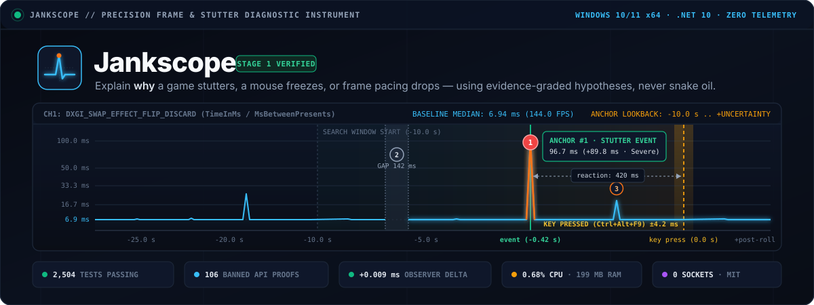
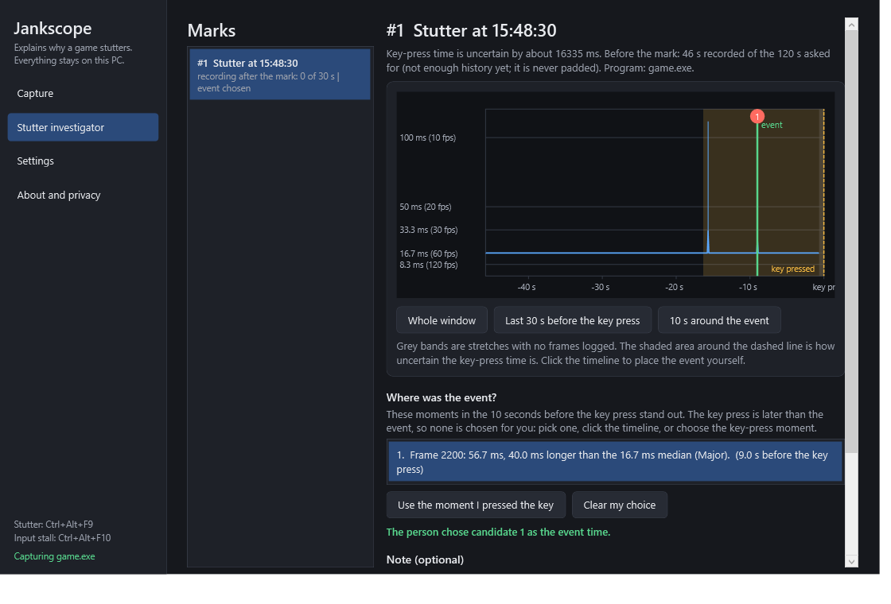
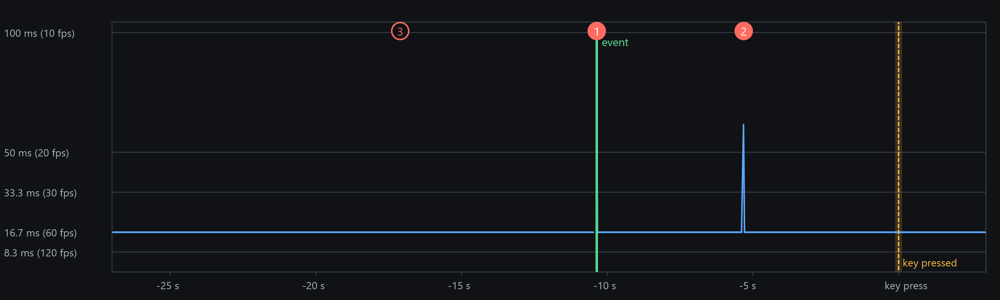
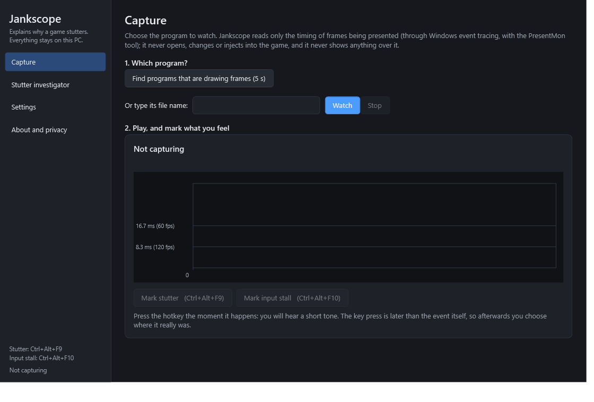
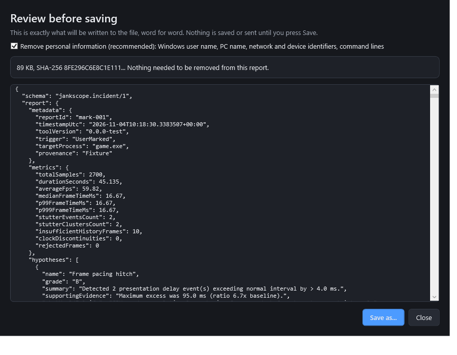
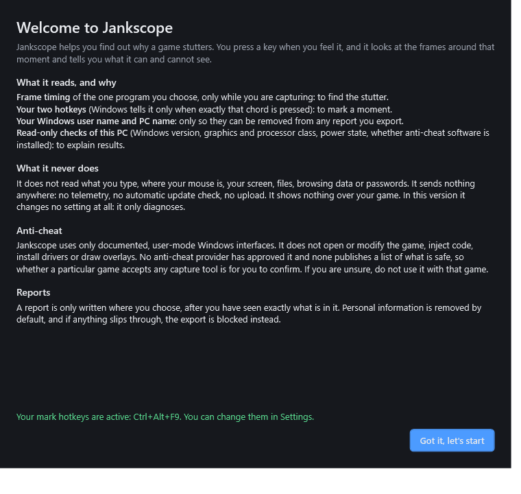
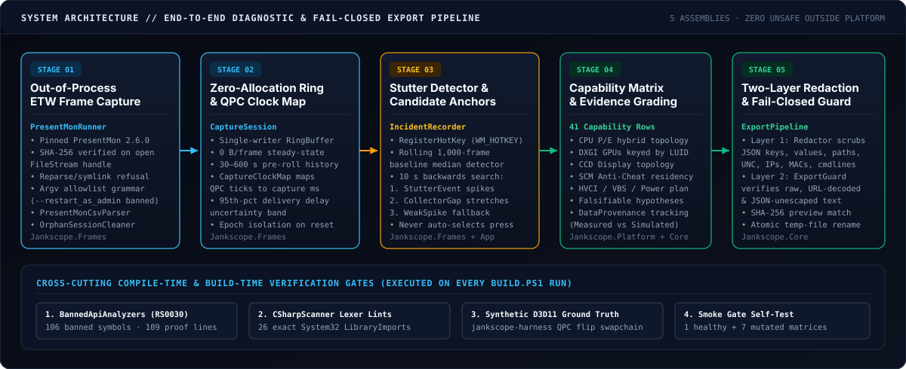
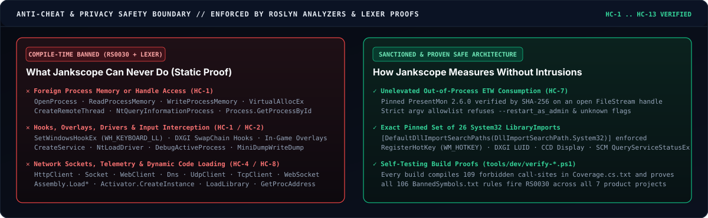
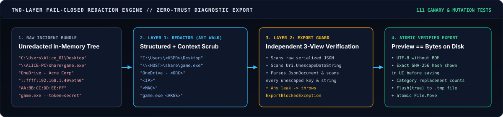
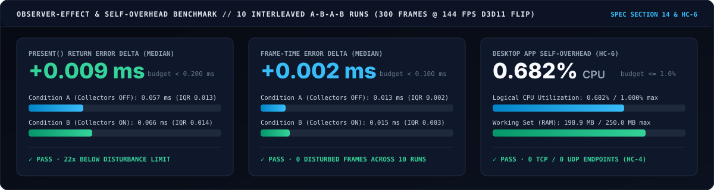

<div align="center">



<br />

**[Why Jankscope](#-the-problem-with-pc-fps-boosters)** · **[Visual Tour](#-interactive-oscilloscope--stutter-investigator)** · **[Architecture](#-five-stage-diagnostic-architecture)** · **[Anti-Cheat Safety Cage](#-compile-time-anti-cheat--privacy-safety-cage)** · **[Observer-Effect Benchmarks](#-measured-observer-effect--self-overhead)** · **[Quickstart](#-quickstart--cli-reference)** · **[Roadmap](#-engineering-roadmap--verification-ledger)**

</div>

---

## Why Jankscope Exists — And Why It Is Not a "Booster"

When a game hitches for `80 ms` mid-firefight or a wireless mouse freezes for half a second, conventional utilities fail in one of two ways:

1. **Intrusive overlays and hooks:** Tools that inject DLLs into the game process, hook `IDXGISwapChain::Present`, or install global `WH_KEYBOARD_LL` hooks (`SetWindowsHookEx`) alter the system they are trying to measure—and increasingly conflict with modern kernel-level anti-cheat drivers.
2. **Unfalsifiable "FPS Booster" snake oil:** Tools that blindly toggle undocumented Windows registry keys, kill background services, or promise "+40% FPS" without measuring whether the change helped, hurt, or broke system stability.

**Jankscope** takes the opposite approach. It is a **free, open-source (MIT), zero-telemetry diagnostic oscilloscope** for Windows 10/11 x64 gaming PCs built around four engineering principles:

| Principle | How Jankscope Implements It |
| :--- | :--- |
| **1. Out-of-Process, Zero-Intrusion Observation (`HC-1` / `HC-2`)** | Jankscope never opens a handle to a game process (`OpenProcess`), never reads or writes foreign memory, never injects code, never installs a hook, and never draws an in-game overlay. Frame timing is consumed out-of-process via Windows Event Tracing (`ETW`) using a SHA-256 handle-verified, pinned PresentMon 2.6.0 console binary. |
| **2. Reaction-Time-Aware Incident Anchoring** | When you feel a hitch and press `Ctrl+Alt+F9`, human reaction time (`200–600 ms`) plus ETW pipe delivery jitter means **the key press is never the event time**. Jankscope maps your monotonic `QueryPerformanceCounter` (QPC) key press onto the capture clock with an explicit uncertainty band, searches the preceding 10 seconds for `StutterEvent` spikes, `CollectorGap` stretches, and `WeakSpike` candidates, and lets you inspect and choose the true event without ever fabricating a default. |
| **3. Falsifiable, Evidence-Graded Hypotheses (`HC-9`)** | Every diagnostic conclusion states its evidence grade, the exact supporting metrics, and **what measurement would falsify it**. Every sample carries compile-time and runtime `DataProvenance` (`Measured`, `Inferred`, `Simulated`, `Fixture`); synthetic or fixture data is blocked from ever being exported as a real measurement. |
| **4. Two-Layer Fail-Closed Privacy (`HC-4`)** | Jankscope has zero network capability in Stage 1 (`System.Net.*` sockets and HTTP clients are banned at compile time). When you export a diagnostic JSON bundle to share on GitHub or Discord, a two-layer pipeline (`Redactor` AST walker + independent `ExportGuard`) scrubs personal identifiers (`<USER>`, `<HOST>`, `<ORG>`, `<IP>`, `<MAC>`, `<EMAIL>`, `<ARGS>`) and verifies raw, URL-decoded, and JSON-unescaped text—failing closed before a single byte touches disk if any canary survives. |

---

## Interactive Oscilloscope & Stutter Investigator

Jankscope ships with both a **native Windows WPF desktop instrument (`jankscope-app.exe`)** and a **headless command-line diagnostic tool (`jankscope.exe`)**, backed by the same lock-free ring buffer and causal detection engine.

### 1. Reaction-Time-Aware Stutter Investigator

When you press **`Ctrl+Alt+F9`** (*Mark Stutter*) or **`Ctrl+Alt+F10`** (*Mark Input Stall*) during gameplay, Jankscope plays a non-blocking PCM audio confirmation chime without stealing window focus, freezes up to **120 seconds of pre-roll history**, and continues collecting **30 seconds of post-roll** frames.

<div align="center">
  
</div>

- **Spike-Preserving Pixel-Bucket Reduction ([`TimelineBuckets.cs`](src/Jankscope.Frames/Incidents/TimelineBuckets.cs)):** A 150-second window at 240 FPS contains **36,000 frames**—far more than the horizontal pixels of a monitor. Naive downsampling or averaging erases single-frame hitches. `TimelineView` reduces each horizontal pixel column into `{MinMs, MedianMs, P95Ms, MaxMs}` so a **single 1-frame spike is mathematically guaranteed to survive at full amplitude** at every zoom level.
- **Explicit Clock Uncertainty ([`CaptureClockMap.cs`](src/Jankscope.Frames/Incidents/CaptureClockMap.cs)):** Every arriving frame is stamped with both its PresentMon capture timestamp and Jankscope's local QPC arrival tick. The minimum recent offset estimates the true clock alignment, while the spread between the minimum and the **95th-percentile delivery delay** is rendered as a shaded amber uncertainty band around your key press.

<div align="center">
  
</div>

---

### 2. Live Capture, Word-for-Word Export Preview & First-Run Transparency

<table>
  <tr>
    <td width="50%" valign="top">
      <h4 align="center">Live Process Scanner &amp; Capture View</h4>
      
      <p>Scan active GPU-presenting applications over a 5-second window or target an executable directly. Non-swapchain GDI presents (<code>PresentMode == "Other"</code>) are filtered and counted explicitly rather than polluting frame-pacing percentiles or silently vanishing.</p>
    </td>
    <td width="50%" valign="top">
      <h4 align="center">Word-for-Word Redacted Export Preview</h4>
      
      <p>Before saving an incident bundle, Jankscope displays the <strong>exact UTF-8 document line-by-line</strong>, its category replacement counts, and its upper-case <strong>SHA-256 digest</strong>. <code>ExportPipeline.WriteAtomic</code> writes those exact previewed bytes via a flushed temporary file and atomic rename.</p>
    </td>
  </tr>
</table>

<details>
<summary><strong>View First-Run Transparency &amp; Anti-Cheat Disclosure Screen (<code>window-welcome.png</code>)</strong></summary>
<br />
<div align="center">
  
</div>
</details>

---

## Five-Stage Diagnostic Architecture

<div align="center">
  
</div>

### Core Mathematical & Systems Foundations

1. **Rolling Baseline Stutter Detection ([`StutterDetector.cs`](src/Jankscope.Frames/Detection/StutterDetector.cs) & [`docs/METRICS.md`](docs/METRICS.md)):**
   - Maintains a causal rolling window of the preceding **1,000 valid frames** (requiring at least `MinHistoryFrames = 60` before judging a frame, counting warm-up frames in `InsufficientHistoryFrames`).
   - A frame of duration $t_i$ against rolling baseline median $m_i$ is flagged as a `StutterEvent` when:
     $$t_i \ge \max\left(2.5 \times m_i,\; m_i + 8.0\text{ ms}\right) \quad \text{and} \quad t_i \ge 16.0\text{ ms}$$
   - Events are classified by excess frame time ($e_i = t_i - m_i$) and ratio ($r_i = t_i / m_i$) into **Mild** ($e_i < 25\text{ ms}$), **Moderate** ($25\text{ ms} \le e_i < 50\text{ ms}$), **Major** ($50\text{ ms} \le e_i < 100\text{ ms}$), and **Severe** ($e_i \ge 100\text{ ms}$ or $r_i \ge 6.0\times$), and grouped into temporal `StutterCluster` episodes when separated by $\le 250\text{ ms}$.
   - Identical results are guaranteed between batch analysis (`StutterDetector.Analyze`) and streaming single-frame ingestion (`StutterDetector.Feed`), verified by property and equivalence tests against [`NaiveStutterOracle.cs`](tests/Jankscope.Frames.Tests/Detection/NaiveStutterOracle.cs).

2. **Candidate Anchor Discovery ([`CandidateAnchorFinder.cs`](src/Jankscope.Frames/Incidents/CandidateAnchorFinder.cs)):**
   - Searches $[t_{\text{mark}} - 10\,000\text{ ms},\; t_{\text{mark}} + u_{\text{clock}}]$ with $2\,000\text{ ms}$ of leading detector context.
   - Ranks up to 5 candidates across three categories:
     1. **`StutterEvent`:** Frames meeting the full stutter definition, ordered by descending `SeverityMs` (excess over baseline median).
     2. **`CollectorGap`:** Stretches where time advanced by $> \max(100\text{ ms},\; 5 \times m)$ with no frame logged ($t_i - t_{i-1} - \Delta t_i > \text{threshold}$), explicitly reporting *"what happened in that stretch cannot be seen"*.
     3. **`WeakSpike`:** Offered after real candidates only when the longest frame in the window is $\ge 1.5\times$ the median and $\ge +3.0\text{ ms}$ excess, clearly labeled as below the stutter threshold.

3. **Direct3D 11 Ground-Truth Synthetic Harness ([`tools/Jankscope.Harness`](tools/Jankscope.Harness)):**
   - To prove the detector and PresentMon pipeline recover the truth rather than agreeing on a bug, `jankscope-harness.exe` creates a real Direct3D 11 `DXGI_SWAP_EFFECT_FLIP_DISCARD` swapchain (hardware adapter or WARP fallback), paces frames using QPC spin-wait against a deterministic `SplitMix64` schedule with injected hitches, and records independent QPC timestamps immediately before and after `IDXGISwapChain::Present()`.

---

## Compile-Time Anti-Cheat & Privacy Safety Cage

<div align="center">
  
</div>

Jankscope does not ask users to take safety pledges on faith. Every safety boundary is **proven automatically on every build** by three independent enforcement layers:

### Layer 1 — Roslyn Symbol-Level Banned-API Analyzer (`RS0030`)
- [`BannedSymbols.txt`](BannedSymbols.txt) contains **106 banned API entries** blocking `System.Diagnostics.Process`, `System.Net.Http`, `System.Net.Sockets`, `System.Net.WebSockets`, `System.Reflection` dynamic invocation, `System.Runtime.InteropServices.Marshal` memory/pointer writers, `Microsoft.Win32.RegistryKey` mutation methods, and WMI method execution.
- On every run of `.\build.ps1`, [`tools/dev/verify-banned-symbols.ps1`](tools/dev/verify-banned-symbols.ps1) compiles [`tools/dev/analyzer-coverage/Coverage.cs.txt`](tools/dev/analyzer-coverage/Coverage.cs.txt) (109 forbidden call-sites + 11 allowed controls) and **fails the build if any single entry in `BannedSymbols.txt` fails to trigger `RS0030`**.
- [`tools/dev/verify-analyzer-wiring.ps1`](tools/dev/verify-analyzer-wiring.ps1) queries MSBuild across all **7 product projects** to prove no project can opt out of `Directory.Build.targets` or downgrade `RS0030`.

### Layer 2 — Custom C# Lexer & Exact Native-Import Gate ([`RepoLintTests.cs`](tests/Jankscope.Core.Tests/RepoLintTests.cs))
- [`CSharpScanner.cs`](src/Jankscope.Core/Linting/CSharpScanner.cs) lexes every `.cs` file in the repository, stripping comments, verifying balanced braces/brackets, rejecting non-ASCII code characters (which could hide homoglyph identifiers), and scanning string literals (including concatenated literals) for forbidden Win32 APIs (`OpenProcess`, `VirtualAllocEx`, `SetWindowsHookEx`, `ReadProcessMemory`, `CreateRemoteThread`, `NtQueryInformationProcess`, etc.).
- Every native P/Invoke in the product must use `[LibraryImport("literal.dll", EntryPoint = "Literal")]`, reside in `Jankscope.Platform` with `[assembly: DefaultDllImportSearchPaths(DllImportSearchPath.System32)]`, and match the exact 26-entry `ApprovedLibraryImports` list in [`RepoLintTests.cs`](tests/Jankscope.Core.Tests/RepoLintTests.cs#L18-L46).

### Layer 3 — Two-Layer Fail-Closed Redaction Engine

<div align="center">
  
</div>

---

## Measured Observer Effect & Self-Overhead

A diagnostic tool must never cause the stutter it is trying to diagnose. Per [`MASTER_PROMPT_v4.md`](MASTER_PROMPT_v4.md) sections 14 & 18, [`tools/dev/Measure-Overhead.ps1`](tools/dev/Measure-Overhead.ps1) executes **10 interleaved A-B-A-B runs** (`5 pairs`, `300 frames @ 144.0 FPS` D3D11 flip-model swapchain with `0.1 ms` synthetic jitter), comparing `jankscope-harness.exe`'s internal QPC `Present()` timestamps with collectors **OFF** (Condition A) versus real-time PresentMon ETW capture **ON** (Condition B):

<div align="center">
  
</div>

| Metric | Condition A (Off, Median / IQR) | Condition B (On, Median / IQR) | Observer Delta ($B - A$) | Hard Budget | Status |
| :--- | :--- | :--- | :--- | :--- | :--- |
| **`Present()` Return Error (Median)** | `0.057 ms` (`IQR 0.013`) | `0.066 ms` (`IQR 0.014`) | **`+0.009 ms`** | `< 0.200 ms` | **PASS (22x under limit)** |
| **`Present()` Return Error (p99)** | `0.175 ms` (`IQR 0.061`) | `0.163 ms` (`IQR 0.028`) | **`-0.012 ms`** | `< 0.500 ms` | **PASS** |
| **Frame-Time Error (Median)** | `0.013 ms` (`IQR 0.002`) | `0.015 ms` (`IQR 0.003`) | **`+0.002 ms`** | `< 0.100 ms` | **PASS (50x under limit)** |
| **Disturbed Frames Across 10 Runs** | `0 frames` | `0 frames` | **`0 frames`** | `0 frames` | **PASS** |
| **`jankscope-app.exe` Logical CPU** | — | `0.682%` | **`0.682%`** | `<= 1.0%` | **PASS (`HC-6`)** |
| **`jankscope-app.exe` Working Set** | — | `198.9 MB` | **`198.9 MB`** | `<= 250.0 MB` | **PASS (`HC-6`)** |
| **Active Network Endpoints** | — | `0 TCP / 0 UDP` | **`0`** | `0` | **PASS (`HC-4`)** |

Full per-run data (`A1..B5`) is recorded in [`docs/benchmarks/overhead-v1.md`](docs/benchmarks/overhead-v1.md).

---

## Quickstart & CLI Reference

### Prerequisites
- **OS:** Windows 10 (22H2+) or Windows 11 (x64)
- **SDK:** [.NET 10 SDK (`10.0.402`)](https://dotnet.microsoft.com/download/dotnet/10.0) (pinned via [`global.json`](global.json); see [`docs/INSTALL.md`](docs/INSTALL.md))
- **ETW Capture Rights:** Your Windows user account should belong to the built-in **Performance Log Users** group so PresentMon 2.6.0 can open an unelevated user-mode ETW session without Administrator prompts.

### 1. Build, Prove & Run the Full Test Suite (`2,505` Tests)

```powershell
# Clone the repository
git clone https://github.com/TejuBoricha/jankscope.git
cd jankscope

# Optional: Fetch and verify the pinned PresentMon 2.6.0 console binary (SHA-256 verified)
powershell -NoProfile -ExecutionPolicy Bypass -File .\tools\fetch-third-party.ps1

# Run restore, Release build (0 warnings), banned-API proof, analyzer wiring proof, 2,505 tests & CLI smoke gate
powershell -NoProfile -ExecutionPolicy Bypass -File .\build.ps1
```

### 2. Launch the Interactive Desktop Instrument (`jankscope-app.exe`)

```powershell
.\src\Jankscope.App\bin\Release\net10.0-windows\jankscope-app.exe
```

1. Select a running game (via **Find programs that are drawing frames (5 s)** or by typing its executable name, e.g., `AimLab_tb.exe`) and click **Watch**.
2. Play normally. Whenever you feel a frame hitch or input stall, press **`Ctrl+Alt+F9`** (Stutter) or **`Ctrl+Alt+F10`** (Input Stall).
3. Open **Stutter investigator**, inspect the 10-second lookback window and ranked candidate anchors on the timeline, pick the true event moment, and click **Preview & export...** to save a SHA-256 verified, redacted diagnostic JSON bundle.

### 3. Headless CLI Commands (`jankscope.exe`)

```powershell
# Print the 41-row runtime capability matrix for this PC (human-readable or redacted JSON)
.\src\Jankscope.Cli\bin\Release\net10.0-windows\jankscope.exe probe
.\src\Jankscope.Cli\bin\Release\net10.0-windows\jankscope.exe probe --json --redact

# Generate an evidence-graded incident diagnosis report from a PresentMon CSV capture
.\src\Jankscope.Cli\bin\Release\net10.0-windows\jankscope.exe incident `
    --from-csv .\tests\fixtures\presentmon\v2.6.0-real-sanitized.csv `
    --out .\incident-report.json
```

<details>
<summary><strong>Example Output: <code>jankscope.exe probe --redact</code> (41 Capability Rows, 14 Probes)</strong></summary>

```text
Jankscope capability matrix  (2026-11-04 10:03:14Z)

[A] os.version                         Windows 11 build 26300 (64-bit)
[A] os.locale                          [REDACTED: sensitive]
[A] cpu.topology                       10 cores (6 performance + 4 efficiency), 16 logical processors
[A] gpu.adapters                       2 adapters: NVIDIA GeForce RTX 4060 Laptop GPU (LUID 0x...), Intel(R) UHD Graphics (LUID 0x...)
[A] display.topology                   1 active display: 1920x1080 @ 144 Hz (internal)
[A] power.status                       AC online, high-performance power scheme
[A] security.hvci                      HVCI policy enabled
[A] security.smart_app_control         Off (0)
[A] anticheat.resident                 Riot Vanguard (service vgk running)
[A] anticheat.state                    Idle (no catalogued protected game running)
[A] etw.user_session                   Available (unelevated user-mode trace session verified)
[A] mode.optimize                      eligible

Probes: 14 ok, 0 failed. Source of each row is in --json output.
```
</details>

### 4. Run the Direct3D 11 Ground-Truth Harness (`jankscope-harness.exe`)

```powershell
.\tools\Jankscope.Harness\bin\Release\net10.0-windows\jankscope-harness.exe run `
    --seed 42 --fps 144 --frames 600 --hitches 4 --extra-ms 35 --jitter-ms 0.2 `
    --out .\harness-capture.csv --window-visible
```

---

## Repository Map & Documentation Architecture

> **AI / Session Continuity Note:** If you are picking up work in a new session or after chat compaction, read [`CONTEXT.md`](CONTEXT.md) first (concise live state), followed by [`HANDOFF.md`](HANDOFF.md) and [`docs/STATUS.md`](docs/STATUS.md).

```text
jankscope/
├── src/
│   ├── Jankscope.Core/          # Portable domain: Stutter metrics, Redactor, ExportGuard, CapabilityMatrix, CSharpScanner lints
│   ├── Jankscope.Platform/      # Win32/DXGI/CCD/SCM/PDH/ETW probes + RegisterHotKey (26 System32-only LibraryImports)
│   ├── Jankscope.Frames/        # RingBuffer, PresentMonCsvParser, PresentMonRunner, StutterDetector, IncidentRecorder, Anchors
│   ├── Jankscope.Cli/           # Headless CLI (`jankscope probe` and `jankscope incident`)
│   └── Jankscope.App/           # WPF Desktop Instrument: MainWindow, TimelineView, ExportWindow, WelcomeWindow, TrayIcon
├── tools/
│   ├── Jankscope.Harness/       # Direct3D 11 flip-model synthetic workload generator with QPC ground-truth verification
│   ├── Jankscope.FakePresentMon/# Deterministic child-process test double for runner supervision & watchdog fault injection
│   └── dev/                     # Build-time proofs: verify-banned-symbols.ps1, verify-analyzer-wiring.ps1, Measure-Overhead.ps1
├── tests/
│   ├── Jankscope.Core.Tests/    # 765 tests: RepoLintTests, Redactor/ExportGuard canary & mutation tests, capability gating
│   ├── Jankscope.Frames.Tests/  # 1,098 tests: StutterDetector equivalence/boundary/allocation, PresentMonRunner, IncidentRecorder
│   ├── Jankscope.Platform.Tests/# 344 tests: Hardware/PDH/SCM probes, OrphanSessionCleaner, HotkeyRegistrar
│   ├── Jankscope.Harness.Tests/ # 266 tests: D3D11 pacing fidelity, exit-test variants (a) & (b), simulated provenance pinning
│   └── Jankscope.App.Tests/     # 32 tests: AppHost, TimelineBuckets spike preservation, WPF UI & live PresentMon E2E test
├── catalogs/                    # Data-only JSON knowledge: anticheat.json, protected_titles.json, vendor_terms.json, vm_markers.json
├── docs/
│   ├── assets/                  # Original SVG architecture/telemetry diagrams & rendered WPF screenshots
│   ├── adr/                     # Architecture Decision Records (0001 through 0008)
│   ├── benchmarks/              # Paired interleaved A-B-A-B observer-effect & self-overhead reports (overhead-v1.md)
│   ├── reviews/                 # Adversarial stage reviews & mutation verification logs (stage-0*.md, stage-1a*.md, stage-1b.md)
│   ├── test-plans/              # Pre-implementation test plans (stage-1a.md, stage-1b.md)
│   ├── ARCHITECTURE.md          # Component boundaries, threading model, and data flow
│   ├── METRICS.md               # Formal mathematical definitions of frame pacing, stutters, clusters, and percentiles
│   ├── STATUS.md                # Evidence-backed progress ledger
│   ├── LIMITATIONS.md           # Explicit register of current boundaries and unexercised environments (L1..L29)
│   └── VALIDATION_1.md          # Step-by-step live-game validation guide for Stage 1
├── BannedSymbols.txt            # 106 symbol-level API bans enforced as build errors (RS0030)
└── build.ps1                    # Single-command restore, build, static proof, test, and smoke verification pipeline
```

---

## Engineering Roadmap & Verification Ledger

Every stage requires a pre-implementation test plan, `0` build warnings, an independent adversarial code and mutation review (`docs/reviews/stage-*.md`) with zero open Critical/High findings, and real hardware evidence in [`docs/STATUS.md`](docs/STATUS.md):

| Stage | Milestone & Scope | Verification Status | Evidence & Review Artifacts |
| :--- | :--- | :--- | :--- |
| **Stage 0** | **Bootstrap & Safety Cage:** Pinned `.NET 10` toolchain, `BannedApiAnalyzers` (`106` rules), lexer lints (`CSharpScanner`), capability matrix prototype, data-only catalogs, ADRs `0001–0007`. | **Done — Verified** | `562` initial tests · [`docs/reviews/stage-0.md`](docs/reviews/stage-0.md) · [`stage-0-pass2-reverify.md`](docs/reviews/stage-0-pass2-reverify.md) |
| **Stage 1a** | **Headless Core:** Lock-free `RingBuffer`, `StutterDetector`, `PresentMonCsvParser`, supervised `PresentMonRunner` with handle SHA-256 verification, `OrphanSessionCleaner`, CPU/GPU(LUID)/Display/PDH probes, D3D11 `jankscope-harness`, CLI `incident` report, A-B-A-B overhead benchmark. | **Done — Verified** | `2,054` tests · [`docs/test-plans/stage-1a.md`](docs/test-plans/stage-1a.md) · [`docs/reviews/stage-1a.md`](docs/reviews/stage-1a.md) · [`stage-1a-reverify.md`](docs/reviews/stage-1a-reverify.md) |
| **Stage 1b** | **Interactive Slice:** `RegisterHotKey` global marker, PCM `AudioCue`, `CaptureClockMap`, `CandidateAnchorFinder`, `IncidentRecorder`, two-layer `Redactor` + `ExportGuard`, WPF `jankscope-app` (`MainWindow`, `TimelineView`, `ExportWindow`), live E2E harness + PresentMon integration test. | **Done — Verified** *(at Owner Live-Game Validation Gate)* | **`2,505` tests (`2,504` passing, `1` skipped)** · [`docs/adr/0008-stage-1b-interactive-slice.md`](docs/adr/0008-stage-1b-interactive-slice.md) · [`docs/reviews/stage-1b.md`](docs/reviews/stage-1b.md) · [`docs/VALIDATION_1.md`](docs/VALIDATION_1.md) |
| **Stage 2** | **Input & Network Correlation:** Raw Input (`WM_INPUT`) device vs. system stall differentiation, display/GPU present correlation, opt-in network route/jitter characterization with honest ICMP limits. | Planned (Next) | [`MASTER_PROMPT_v4.md` §17](MASTER_PROMPT_v4.md) |
| **Stage 3** | **Expanded Diagnosis:** Opt-in elevated ETW DPC/ISR & CPU scheduling correlation (strictly gated by `AntiCheatSafety.Decide`), expanded catalog coverage. | Planned | [`MASTER_PROMPT_v4.md` §17](MASTER_PROMPT_v4.md) |
| **Stage 4** | **Controlled, Reversible Optimization:** Evidence-gated setting recommendations with mandatory before/after A/B verification and automatic transactional rollback. | Planned | [`MASTER_PROMPT_v4.md` §17](MASTER_PROMPT_v4.md) |
| **Stage 5** | **Hardening, Signing & Release:** Accessibility audit, crash-recovery stress campaign, SignPath code signing ([`ADR 0007`](docs/adr/0007-signing-and-distribution.md)), public release gate. | Planned | [`MASTER_PROMPT_v4.md` §17](MASTER_PROMPT_v4.md) |

---

## Contributing, Security & License

- **Contributing:** Read [`CONTRIBUTING.md`](CONTRIBUTING.md) before submitting changes. All pull requests must pass `.\build.ps1` with `0` warnings and preserve all `HC-1` .. `HC-13` proofs.
- **Security Policy:** See [`SECURITY.md`](SECURITY.md) for our threat model and vulnerability reporting process.
- **Honest Limitations:** Everything partial, unverified, or not yet exercised on specific hardware/OS configurations is documented transparently in [`docs/LIMITATIONS.md`](docs/LIMITATIONS.md) and [`docs/COMPATIBILITY.md`](docs/COMPATIBILITY.md).
- **License:** Distributed under the [MIT License](LICENSE). Third-party dependency notices and exact version/license mappings are maintained in [`docs/THIRD_PARTY.md`](docs/THIRD_PARTY.md).
