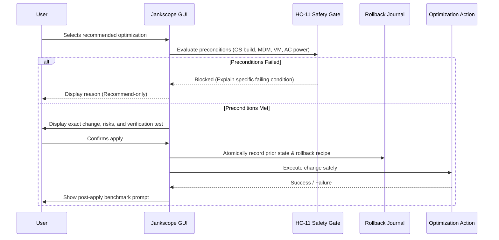

# Optimization Engine Architecture (Stage 4)

> [!IMPORTANT]
> **Stage 4 Feature Specification.** Jankscope currently operates in read-only diagnostic mode (Stages 0–2). No system modifications are applied to the user's PC until Stage 4.

This document establishes the safety architecture, precondition evaluation rules, and action classification model for system optimizations (spec §11).

---

## 1. Ethical & Safety Guardrails (HC-11)

Traditional "PC booster" applications indiscriminately apply bulk registry tweaks, disable critical security services, or terminate background processes without measuring real-world impact.

Jankscope adheres to strict safety invariants:
1. **Never Automatic:** Optimization actions are **never applied silently or automatically**. Each change requires individual, explicit user consent.
2. **Precondition Gating:** If a machine is domain-joined, MDM-managed, running in a virtual machine, or running an unsupported Windows build, the system locks into **Recommend-only** mode (HC-11).
3. **No Security Compromises:** Disabling Windows Defender, tamper protection, user account control (UAC), hypervisor-protected code integrity (HVCI), or firewall services is strictly forbidden.
4. **Evidence-Backed Only:** An optimization is recommended only if empirical diagnostic data from an incident capture supports its relevance.

---

## 2. Action Classification Taxonomy

Every optimization action in the catalog is categorized by its reversibility, scope, and blast radius:

| Class | Description | Preconditions | Rollback Mechanism |
|---|---|---|---|
| **Class 1: User Profile Settings** | Settings scoped purely to the current user (e.g. Game Bar background recording, Windows Graphics scheduling). | Standard user account; unmanaged. | Exact original value restored from journal. |
| **Class 2: Driver & Device Posture** | Scoped to GPU driver settings or power plans (e.g. disabling aggressive PCIe link state power saving on desktop). | AC power; desktop chassis. | Original power plan GUID or registry state restored. |
| **Class 3: System Service Configuration** | Non-essential service adjustments (e.g. pausing Windows Search indexing during active gaming sessions). | Elevated helper approval; non-domain. | Service startup type restored to previous configuration. |

---

## 3. The Action Lifecycle & Execution Pipeline

