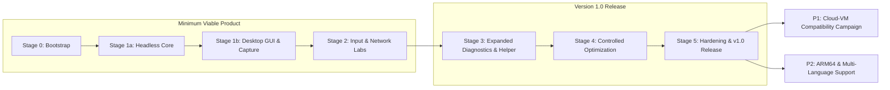

# Jankscope Project Roadmap

This roadmap outlines the phased development lifecycle of Jankscope, establishing clear release tiers and quality gates from bootstrap to production release.

---

## 1. Release Tiers Overview

---

## 2. Stage Breakdown & Milestones

### Tier 1: Minimum Viable Product (MVP)

#### Stage 0: Bootstrap & Foundations (Complete)
- **Scope:** Repository layout, strict .NET 10 LTS toolchain, banned-API static analyzer (106 rules), data-only schema catalogs, architectural ADRs 0001–0007.
- **Verification:** 100% build pass, verified banned symbols analyzer, clean licensing compliance.

#### Stage 1a: Headless Diagnostic Core (Complete)
- **Scope:** 14 system capability probes (41 capability rows), Intel PresentMon 2.6.0 runner integration, ring buffer frame storage, stutter detection algorithm, synthetic D3D11 harness, CLI diagnostic report.
- **Verification:** Independent code review closed, benchmark overhead verified (median `Present()` error delta +0.009 ms against a 0.200 ms budget; `docs/benchmarks/overhead-v1.md`).

#### Stage 1b: Desktop GUI & Incident Investigator (Complete)
- **Scope:** Unelevated WPF desktop interface, live 30 s pacing timeline, global stutter/stall hotkey capture (`RegisterHotKey`), candidate anchor detection, redaction engine and byte-exact export preview.
- **Verification:** Live end-to-end harness validation, all 6 review findings resolved, CI automated workflow.

#### Stage 2: Input & Network Labs (Current Milestone)
- **Scope:** Raw Input timing collector (zero keylogging per HC-4), Kernel-PnP USB event monitoring, motion-continuity differential diagnosis (idle vs. hitch), local network/gateway latency probes, WLAN signal stability monitor.
- **Deliverables:** `docs/adr/0009-stage-2-input-and-network.md`, `docs/test-plans/stage-2.md`, input/network capability probes.

---

### Tier 2: Version 1.0 General Availability

#### Stage 3: Expanded Diagnostics & Elevated Helper
- **Scope:** Out-of-process architecture (ADR 0002), authenticated named-pipe IPC, DPC/ISR driver latency monitors, storage queue latency / WHEA hardware error trackers, resident anti-cheat coexistence verification.

#### Stage 4: Controlled Optimization & Rollback
- **Scope:** Evidence-based optimization recommendations, strict precondition evaluation (HC-11), atomic journal with automated rollback on reboot, benchmark A/B verification protocol.

#### Stage 5: Hardening, Packaging & Release
- **Scope:** Self-contained MSIX/Zip packaging, automated CycloneDX SBOM generation, SignPath code signing, Microsoft Store submission, external beta test program.

---

### Tier 3: Post-v1.0 Enhancements (P1 & P2)

- **P1: Cloud-VM Compatibility Campaign:** Automated validation across Azure NV-series, AWS G4/G5, and GCP GPU instances.
- **P2: Platform Expansion:** Windows on ARM64 native binary build, community catalog update packs, multilingual UI translations.
